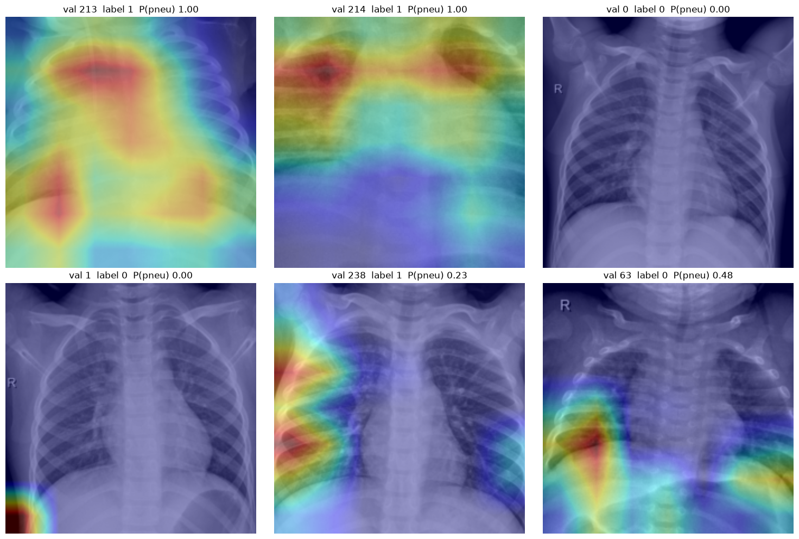

# chest-xray-pneumonia

Classify pediatric chest X-rays as normal or pneumonia. The question: how much does ImageNet pretraining help on a small medical dataset, and is the model looking at the lungs or at shortcuts?

**Not for clinical use.** A learning project on a public dataset.

## Data

[Chest X-Ray Images (Pneumonia)](https://www.kaggle.com/datasets/paultimothymooney/chest-xray-pneumonia) on Kaggle. Only the top-level `chest_xray/` folders are used.

```bash
kaggle datasets download paultimothymooney/chest-xray-pneumonia
unzip chest-xray-pneumonia.zip "chest_xray/train/*" "chest_xray/val/*" "chest_xray/test/*" -d data/
```

Images are not in this repo.

## What's in the data

- **74% pneumonia.** Always guessing "pneumonia" scores 74% accuracy, so accuracy alone means little. I report recall, specificity, precision, F1 and ROC-AUC.
- **The classes differ in ways that aren't the disease.** Normal scans are bigger (median 1640×1328 vs 1168×776) and squarer (aspect ratio 1.23 vs 1.51). 283 pneumonia images are RGB; every normal one is grayscale. A model could learn these instead of the lungs. So every image is converted to RGB, resized so its short side is 224, then center-cropped to 224×224. Nothing gets stretched. Sharpness still differs, and that can't be removed.
- **Some images have burned-in text:** "R" markers, scanner settings, study IDs. Seen in samples, not counted. Grad-CAM will check where the model looks.
- **One child can have many X-rays,** up to 30. Splitting by image would put the same chest in train and val. So I pooled the official train and val (the official val has only 16 images) and split 85/15 by patient: 4,453 train, 779 val, zero shared patients. Saved in `splits/`. Pneumonia patients come from the `personNNN` prefix. Normal files have no patient ID, so I assume the `IM-NNNN` prefix is one study.

## Pipeline

- Transforms: resize short side to 224, center-crop 224, normalize with ImageNet mean/std. Training adds a random rotation of up to 10°. No horizontal flip: a flipped chest puts the heart on the wrong side.
- Loading takes 7 s per epoch with 4 workers, so it isn't the bottleneck.

## Results (val)

Four models, same data, same training loop, same metrics. Only the model changes.

- **SmallCNN:** 5 blocks of conv, batch norm, ReLU and max-pool, then global average pooling and one linear layer. Random start.
- **ResNet-18 scratch:** the standard ResNet-18, random start.
- **ResNet-18 frozen:** ImageNet weights, locked. Only a new 2-class head trains.
- **ResNet-18 fine-tuned:** ImageNet weights, everything trains.

| | SmallCNN | ResNet scratch | ResNet frozen | ResNet fine-tuned |
|---|---|---|---|---|
| Trainable params | 980k | 11.2M | 1,026 | 11.2M |
| Recall | 0.982 | 0.979 | 0.975 | **0.984** |
| Specificity | 0.949 | 0.944 | 0.935 | **0.977** |
| Precision | 0.981 | 0.979 | 0.975 | **0.991** |
| F1 | 0.981 | 0.979 | 0.975 | **0.988** |
| ROC-AUC | 0.996 | 0.996 | 0.994 | **0.999** |
| Missed (of 564 sick) | 10 | 12 | 14 | **9** |
| False alarms (of 215 healthy) | 11 | 12 | 14 | **5** |
| Best val loss | 0.078 | 0.077 | 0.095 | **0.039** |

What it says:

- **Bigger alone doesn't help.** ResNet-18 from scratch has 11× the parameters of SmallCNN and scores the same. It just memorizes more: its train loss ends at 0.02, SmallCNN's at 0.05.
- **Frozen ImageNet features get surprisingly close.** Only 1,026 numbers are trained, a single linear layer on top of features learned from everyday photos, and it makes 28 errors against 21–24 for the models trained fully on X-rays.
- **Fine-tuned ImageNet features are the best,** with 14 errors against 21–28, and half the val loss. One run on one split, so it's a small but clear edge, not a huge win. The test set will settle it.

### The BatchNorm bug in the frozen model

The first frozen run scored much worse (best val loss 0.149, 37 errors). The cause: the training loop calls `model.train()`, which puts BatchNorm layers in training mode. Their weights were locked, but their running averages kept updating toward X-ray statistics. So the "frozen" features changed every epoch, and the head was learning on a moving target.

How to see it: a linear layer on fixed features should train smoothly, but train loss bounced (0.16, 0.24, 0.19, 0.24) and never went below 0.11. A direct check in the notebook: run 5 batches through a frozen model with no loss and no optimizer, so no weight can change. In train mode, the first BatchNorm layer's running mean still moves, by 0.144 on average. In eval mode it moves by exactly 0.

The fix: put the frozen model back in `model.eval()` after `model.train()`. Eval mode still lets the head learn; it only stops BatchNorm from updating. The fix confirmed the cause: train loss now reaches 0.06, best val loss dropped from 0.149 to 0.095, and errors from 37 to 28.

Training: SGD with momentum 0.9, batch 32, 15 epochs, lr dropped 10× after epoch 10. lr 0.01 for everything except fine-tuning, which uses 0.001 so the first updates don't wreck the pretrained weights. Each model keeps the weights from its epoch with the lowest val loss.

The lr drop mattered. For SmallCNN, val loss jumped between 0.086 and 0.27 before it and stayed between 0.078 and 0.083 after it.

The metrics are written from scratch and match sklearn to 4 decimals.

Each row is one run. Two runs with the same seed don't give identical curves: some GPU convolution algorithms add numbers in a slightly different order each time. An earlier fine-tuned run gave 3 false alarms instead of 5. So differences of a few images are noise. Fine-tuned's lead is bigger than that; the gaps among the other three are not.

### Choosing a threshold

Missing a sick child costs more than a false alarm, so 0.5 isn't the right cut. For the fine-tuned model, the highest threshold that still catches 99% of pneumonia on val is 0.247:

| Threshold | Missed (of 564) | False alarms (of 215) | Specificity |
|---|---|---|---|
| 0.5 | 9 | 5 | 0.977 |
| 0.247 | 5 | 8 | 0.963 |

4 fewer missed, 3 more false alarms. The threshold is picked on val, so its val numbers are optimistic. It also rests on just 5 misses, so one image more or less moves it a lot. On test it's used unchanged.

Class weights (normal ×2.9) didn't help: at 99% recall, 9 false alarms vs 8 without. Weighting mostly shifts the probabilities, which choosing the threshold already does.

Take these with salt. Val is used to choose epochs, so it's optimistic, and this dataset's test set is known to be harder. The test set gets used once, at the end.

## Grad-CAM

Where does the fine-tuned model look? Grad-CAM colors the parts of the image that pushed it toward "pneumonia" (red = most). Written from scratch with hooks on the last conv block. Six val images at threshold 0.247: two correct pneumonia, two correct normal, one miss, one false alarm.



First look, six images only:

- On the two confident pneumonia cases, the heat is on the chest and lung fields. Not on the "R" markers.
- On the two confident normals, there's almost no heat, as expected. The red spot in one corner is probably noise: each map is scaled to its own max, so a near-empty map gets its tiny peak stretched to full red.
- On the miss (P = 0.23), the heat is on the image edge and chest wall, not the lungs.

Six images can't settle whether the model uses shortcuts. Next: all misses and false alarms, and a number for how much heat falls on the image border.

## To do

- Grad-CAM on all misses and false alarms, and border heat as a number
- Test set, once
- Limitations
